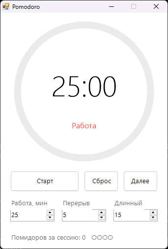

<div align="center">

# 🍅 PomodoroTimer

**Таймер по технике Pomodoro: 25 минут фокуса, 5 минут отдыха**




</div>

## ✨ Возможности

- ⭕ Наглядное кольцо прогресса
- 🔄 Цикл: работа → короткий перерыв, каждый 4-й перерыв длинный
- ⚙️ Настраиваемая длительность работы и перерывов
- 🔔 Звук и уведомление Windows по окончании этапа
- ⏸️ Пауза, сброс и пропуск этапа
- 🏷️ Оставшееся время видно в заголовке окна и на панели задач
- 🎯 Точный отсчёт по системным часам, без накопления погрешности

## 🍅 Что такое Pomodoro?

1. Работаешь 25 минут, ни на что не отвлекаясь
2. Отдыхаешь 5 минут
3. После четырёх «помидоров» делаешь длинный перерыв на 15 минут

## 📥 Установка

1. Скачай `PomodoroTimer.exe` из раздела [**Releases**](../../releases/latest)
2. Запусти его, установка не нужна

## 🛠️ Сборка из исходников

Нужен только Windows: компилятор C# входит в состав .NET Framework.

```bat
build.bat
```

## 📄 Лицензия

[MIT](LICENSE)
